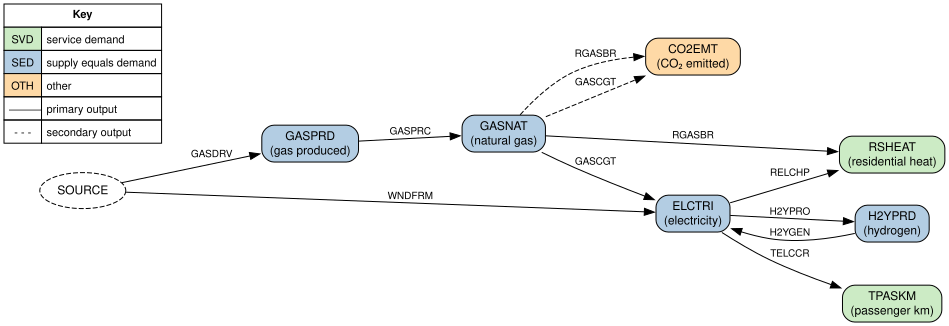
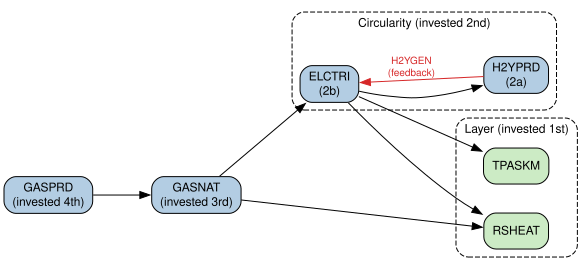
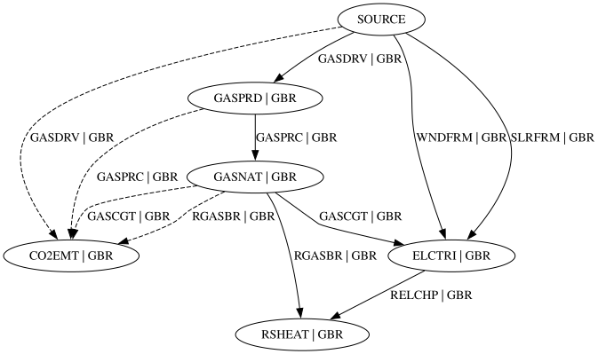

# Commodity Graphs

When MUSE2 loads a model, it uses your commodity, process and process flow input files to build a
**commodity graph** for each milestone year. You never write these graphs yourself, but they
underpin how MUSE2 checks and runs your model. Understanding them will help you to build models
that work, and to work out what has gone wrong when they don't.

## Why MUSE2 builds commodity graphs

- **To map out how commodities can flow.** The graph records which commodities each process can
  turn into which other commodities, in each region. In other words, it captures the structure of
  your energy system.
- **To validate your model.** MUSE2 checks that every service demand can be met by the available
  processes, and that every commodity obeys the rules for its type (see
  [Validating the graph](#validating-the-graph)).
- **To protect the integrity of the system.** Structural mistakes, such as a missing process or a
  commodity with the wrong type, are caught with a clear error message when the model is loaded,
  rather than causing confusing failures partway through a run.
- **To decide the order of investment and price calculations.** MUSE2 invests from downstream to
  upstream (e.g. in residential heating before electricity, and in electricity before gas) and
  calculates prices from upstream to downstream (see
  [Investment and price order](#investment-and-price-order)).
- **To identify circularities**, where commodities depend on one another in a loop (e.g.
  electricity is used to make hydrogen, which is used to generate electricity). These need special
  treatment during [investment][investment-circularities] and [pricing][pricing-circularities].
- **To help you visualise your model**, via the `muse2 save-graphs` command (see
  [Visualising your model](#visualising-your-model)).
- **For performance.** The graph shows which markets are independent of one another. MUSE2 already
  uses this to group independent markets together, and in future it could allow independent parts
  of a model to be solved in parallel.

## What's in a commodity graph

- Each **node** is a [commodity market][glossary]: one commodity in one region (e.g. electricity in
  GBR).
- Each **edge** is a process, drawn as an arrow from an input commodity to an output commodity. A
  process with several inputs or outputs is drawn as several edges, one for each input/output pair.
- Processes with no inputs (e.g. wind farms or gas extraction) are drawn from a special `SOURCE`
  node. Processes with no outputs are drawn to a special `SINK` node.
- Edges are either **primary** or **secondary**:
  - a **primary** edge leads to the process's primary output (the `primary_output` column in
    `processes.csv`). This is the market in which agents can invest in the process.
  - a **secondary** edge leads to any other output, such as CO₂ emitted as a by-product.

MUSE2 builds a separate graph for each milestone year, as the available processes can change over
time. A process is included in a year's graph if an asset of that process *could* be operating in
that year, taking into account the process's start and end years and its lifetime.

### Example

Consider a single-region model with the following processes. This is a simplified version of the
`circularity` [example model][example models].

| Process | Description           | Inputs | Outputs (primary output in bold) |
| ------- | --------------------- | ------ | -------------------------------- |
| GASDRV  | Gas extraction        | –      | **GASPRD**                       |
| GASPRC  | Gas processing        | GASPRD | **GASNAT**                       |
| WNDFRM  | Wind farm             | –      | **ELCTRI**                       |
| GASCGT  | Gas turbine           | GASNAT | **ELCTRI**, CO2EMT               |
| H2YPRO  | Hydrogen electrolyser | ELCTRI | **H2YPRD**                       |
| H2YGEN  | Hydrogen turbine      | H2YPRD | **ELCTRI**                       |
| RGASBR  | Gas boiler            | GASNAT | **RSHEAT**, CO2EMT               |
| RELCHP  | Heat pump             | ELCTRI | **RSHEAT**                       |
| TELCCR  | Electric car          | ELCTRI | **TPASKM**                       |

Figure 1 shows the commodity graph for this model, with nodes coloured by commodity type.



*Figure 1: Commodity graph for the example model.*

Note that the gas turbine (GASCGT) appears as two edges: a solid edge to its primary output
(electricity) and a dashed edge to CO₂, which it emits as a by-product. Electricity and hydrogen
form a **circularity**, as electricity is used to produce hydrogen (H2YPRO), which can be used to
generate electricity (H2YGEN).

## Validating the graph

When you run `muse2 validate` or `muse2 run`, MUSE2 checks each year's graph against the rules for
each commodity type. As process availabilities and service demands can vary through the year, the
checks are repeated for each part of the year, at the level given by the commodity's
`time_slice_level` (in `commodities.csv`):

- `annual` commodities are checked once for the whole year;
- `season` commodities are checked for each season;
- `daynight` commodities are checked for each individual time slice.

For each check, any process that cannot operate during that period (i.e. its availability in
`process_availabilities.csv` is zero throughout the period) is removed from the graph, and the
service demand for that period is taken into account. The rules are:

| Commodity type | Rule |
| --- | --- |
| `svd` | Cannot be an input to any process; if demanded, it must have a producer. |
| `sed` | If any process can consume it, a process must be able to produce it. |
| `oth` | Can be produced or consumed, but not both. |

### Diagnosing validation errors

If one of these rules is broken, MUSE2 will tell you which commodity, region, year and period
caused the problem. For example, if the electrolyser (H2YPRO) were removed from the example model
above, you would see:

```txt
Caused by:
    0: Error validating commodity graph for 2020 in winter
    1: SED commodity H2YPRD in region GBR may be consumed but has no producers
```

Hydrogen can still be consumed by the hydrogen turbine, but there is nothing left to produce it.
The problem was found in the season `winter`, as hydrogen has a `season` time slice level. MUSE2
stops at the first problem it finds, so the same problem may affect other seasons too.

Some tips for fixing validation errors:

- **Look at the graph** for the year in the error message using
  [`muse2 save-graphs`](#visualising-your-model), which works even when validation fails.
- **If the error only occurs in some periods, check process availabilities.** For example, solar
  alone cannot supply a `daynight` commodity at night.
- **If the error only occurs in some years, check process start/end years and lifetimes.**
- **Check commodity types.** For example, CO₂ that is both emitted and captured for storage must be
  `sed` rather than `oth`.

Note that validation only checks the structure of the model. It does not check whether there is
enough capacity to meet demand, whether costs are sensible, or whether agents are able to invest in
the processes they need, so a model that passes validation can still fail when it is run.

## Investment and price order

In each milestone year, MUSE2 invests in one market (or group of markets) at a time, from the most
downstream to the most upstream, so that demand from assets already selected downstream (e.g. heat
pumps consuming electricity) is known when upstream markets are invested in (see
[Investment Appraisal][investment]). Prices are calculated in the reverse order, so that the prices
of a process's inputs are known before the price of its output is calculated (see
[Commodity Prices][prices]).

The investment order is worked out from the commodity graph for each year as follows:

1. **Keep only the markets that are invested in.** Only `svd` and `sed` markets are kept. `oth`
   commodities and the `SOURCE` and `SINK` nodes are ignored. Both primary and secondary edges are
   kept.
2. **Group circularities.** Each set of markets that form a loop is treated as a single group (in
   graph theory terms, the strongly connected components of the graph are collapsed into single
   nodes), with the markets inside it ordered as described in [Circularities](#circularities). The
   graph now has no loops.
3. **Sort the markets.** The markets are put in order so that every market comes before the
   markets that supply it (a [topological sort]).
4. **Group independent markets into layers.** Each market is given a depth, which is the length of
   the longest supply chain leading to it. Markets with the same depth do not depend on one another,
   so they are grouped into a **layer**. MUSE2 invests in all markets in a layer before running a
   single [partial system dispatch][partial-dispatch], rather than one per market, which saves time.

### Circularities

In a circularity, each market in the loop is both upstream and downstream of the others, so whatever
order the markets are put in, at least one of them will be invested in before all of its demand is
known. In the [example model](#example):

- if electricity is invested in first, any electricity demand from hydrogen electrolysers (H2YPRO)
  isn't yet known;
- if hydrogen is invested in first, any hydrogen demand from hydrogen turbines (H2YGEN) isn't yet
  known.

The processes that cause this are called **feedback processes**. A feedback process is one that
consumes a market in the circularity which comes *earlier* in the investment order than the market
it supplies, i.e. it flows the wrong way through the investment order. For example, if hydrogen is
invested in before electricity, H2YGEN is a feedback process.

A circularity may involve only a few commodities (like this one), but may involve many and cover
a large part of your model. MUSE2 handles them all in the same way: it chooses an order for the
markets in the circularity, which in turn determines its feedback processes. These are then treated
specially during [investment][investment-circularities] and [pricing][pricing-circularities].

#### Choosing an order

The order for each circularity must satisfy the following rule:

- **Every market must keep at least one producer that isn't a feedback process.** Without its
  feedback processes, a circularity is no longer a loop, and this rule ensures that the demand for
  every market can still be met, either from outside the circularity or from markets later in the
  order. This allows MUSE2 to invest in the circularity without feedback processes, following the
  normal downstream-to-upstream rules (see [Investment Appraisal][investment-circularities]).

In the example model, this means that hydrogen must be invested in first. If electricity came
first, the electrolyser (H2YPRO) would be a feedback process, leaving hydrogen with no other
producer.

Of the orders that satisfy this rule, MUSE2 chooses the one with the **fewest conflicts** (i.e.
pairs of markets linked by one or more feedback processes). If several orders are equally good, it
prefers to put markets that supply markets downstream of the circularity first.

MUSE2 finds this order when the model is loaded by solving a small optimisation problem (a
mixed-integer linear program, or MILP); for details, see the
[API documentation for `order_scc`][order-scc]. If no order satisfies the rule, MUSE2 stops with an
error.

> **Note:** sometimes several orders are equally good. In this case, MUSE2 will pick one of them,
> and the choice may depend arbitrarily on factors such as the order of rows in the input data or
> the machine that the model is running on. This may affect your results. You can see which order
> and feedback processes were chosen in the [log](#checking-the-investment-order-for-your-model).

### Example investment order

Figure 2 shows the investment order for the [example model](#example). CO2EMT (an `oth` commodity)
and the `SOURCE` node are ignored, and electricity and hydrogen are grouped into a circularity, with
hydrogen invested in first and H2YGEN identified as a feedback process. Residential heat and
passenger kilometres have no dependencies between them, so they form a layer.



*Figure 2: Investment order for the example model. Investment proceeds from right to left and
prices are calculated in the reverse order, from left to right.*

### Checking the investment order for your model

If you set the [log level] to `debug`, MUSE2 will print the investment order for each milestone
year in which it makes investments, and the feedback processes for each circularity. For the
example model, this looks like:

<!-- markdownlint-disable MD013 -->

```txt
Investment order for year '2030': [TPASKM|GBR, RSHEAT|GBR] -> (H2YPRD|GBR, ELCTRI|GBR) -> GASNAT|GBR -> GASPRD|GBR
...
Starting investment for cycle '(H2YPRD|GBR, ELCTRI|GBR)' with feedback processes: [H2YGEN|GBR]
```

<!-- markdownlint-enable MD013 -->

Each market is written as `COMMODITY|REGION` and each process as `PROCESS|REGION`. Square brackets
(`[...]`) show a layer and round brackets (`(...)`) show a circularity, with its markets in
investment order. Markets within a layer are independent, so their order within the layer doesn't
matter.

## Visualising your model

To draw the commodity graphs for your model, run:

```sh
muse2 save-graphs path/to/model
```

This writes one file per milestone year (e.g. `2020.dot`) to `muse2_graphs/<model name>/`. You
can choose a different folder with the `--output-dir` option (see the
[command line help][save-graphs]). The files are in [DOT format], which you can draw with
[Graphviz] (e.g. `dot -Tsvg 2020.dot -o 2020.svg`) or by pasting them into [Graphviz Online].

Figure 3 shows the output for the `simple` example in 2020, which you can reproduce by running
`muse2 example extract simple` followed by `muse2 save-graphs simple`.



*Figure 3: Output of `muse2 save-graphs` for the `simple` example in 2020.*

When reading these graphs, note that:

- nodes are labelled `COMMODITY | REGION` and edges are labelled `PROCESS | REGION`;
- dashed edges are secondary outputs;
- nodes are not coloured by commodity type, so check `commodities.csv` to see which commodities are
  `svd`, `sed` or `oth`;
- the graph shows every process that could operate in that year. It does not take into account
  process availabilities or service demands, which are only considered during
  [validation](#validating-the-graph).

[glossary]: ../glossary.md
[example models]: ../examples.md
[investment]: ./investment.md
[prices]: ./prices.md
[topological sort]: https://en.wikipedia.org/wiki/Topological_sorting
[partial-dispatch]: ./investment.md#partial-system-dispatch
[order-scc]: ../api/muse2/graph/investment/fn.order_scc.html
[investment-circularities]: ./investment.md#circularities
[pricing-circularities]: ./prices.md#circularities
[log level]: ../user_guide.md#setting-the-log-level
[save-graphs]: ../command_line_help.md#muse2-save-graphs
[DOT format]: https://graphviz.org/doc/info/lang.html
[Graphviz]: https://graphviz.org/
[Graphviz Online]: https://dreampuf.github.io/GraphvizOnline
